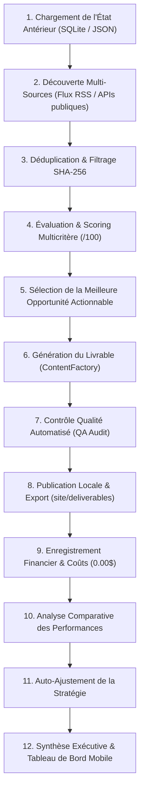

# 🤖 AGENTS.md - Guide Opérationnel pour Agents IA Autonomes

> **Système** : AUTO-INCOME AI  
> **Mission** : Découvrir, sélectionner et packager des actifs numériques monétisables à l'international pour un utilisateur basé à Madagascar, avec un budget initial de 0 USD.

---

## 🏛️ 1. Principes Fondamentaux de Conception

1. **Règle Absolue du Coût Zéro (0 USD)** :
   - Tout composant, outil, script ou dépendance doit fonctionner sans aucun abonnement payant.
   - Les APIs externes payantes sont interdites pour les fonctionnalités de base. Seules les APIs à quota réellement gratuit (ex : Gemini API free tier) sont autorisées en tant qu'enrichissements optionnels.
2. **Honnêteté et Traçabilité Intégrale** :
   - Ne jamais simuler de faux clients, fausses ventes ou fausses transactions.
   - Les données issues de tests ou de démonstration sont obligatoirement taguées `is_simulated: true` ou `[DEMO]`.
3. **Persistance Idempotente** :
   - Chaque opportunité découverte est identifiée par un hash SHA-256 unique (`source_id:title`).
   - Une opportunité déjà traitée ne doit jamais être dupliquée.

---

## 🔄 2. Le Cycle Décisionnel en 12 Étapes



---

## 📊 3. Matrice de Scoring Multicritère (Sur 100 points)

Chaque opportunité est soumise à une formule transparente :

$$\text{Score Global} = \text{Demande} + \text{Coût Zéro} + \text{Rapidité} + \text{Faisabilité} + \text{Compatibilité Madagascar}$$

| Critère | Poids Max | Règle d'Attribution |
| :--- | :--- | :--- |
| **Demande Observable** | 25 pts | Analyse des requêtes réelles, mots-clés d'intention d'achat, concurrence. |
| **Coût de Démarrage Nul** | 20 pts | 20 pts si 0 $ de dépense requise ; 0 pt si paiement préalable exigé. |
| **Délai avant Premier Revenu** | 20 pts | Microservices (19 pts) > Produits digitaux (17 pts) > SEO (14 pts) > Outils (13 pts). |
| **Accessibilité Technique** | 15 pts | Automatisation directe en Python/HTML sans friction complexe. |
| **Encaissement Madagascar** | 20 pts | USDT P2P (20 pts), ComeUp (19 pts), Payoneer (18 pts), Ko-fi (18 pts), Gumroad (16 pts). |

---

## 🇲🇬 4. Passerelles de Paiement & Encaissement à Madagascar

Pour un créateur opérant depuis Madagascar, les rails suivants sont configurés :
- **Crypto USDT TRC20 / BEP20** : Reçu directement sur portefeuille puis converti en **MVola** ou **Orange Money** via Binance P2P en moins de 10 minutes.
- **ComeUp (ex-5euros)** : Microservices facturés en Euros, avec virement vers compte bancaire local (BNI, BOA, BMOI) ou compte Payoneer.
- **Payoneer** : Fournit un compte bancaire virtuel US/EU/UK et une carte Mastercard internationale utilisable à Madagascar.
- **Ko-fi & Gumroad** : Pages de vente gratuites pour héberger les produits numériques générés.

---

## 🛠️ 5. Interaction CLI & Tests

Pour tester ou exploiter l'agent :
```bash
# 1. Exécuter un cycle complet en conditions réelles
python main.py --run

# 2. Exécuter en mode simulation (démo hors-ligne)
python main.py --simulate

# 3. Consulter les indicateurs clés (KPIs)
python main.py --status

# 4. Régénérer le tableau de bord HTML pour mobile
python main.py --report

# 5. Lancer l'intégralité des tests unitaires
python -m unittest discover -s tests -p "test_*.py"
```
